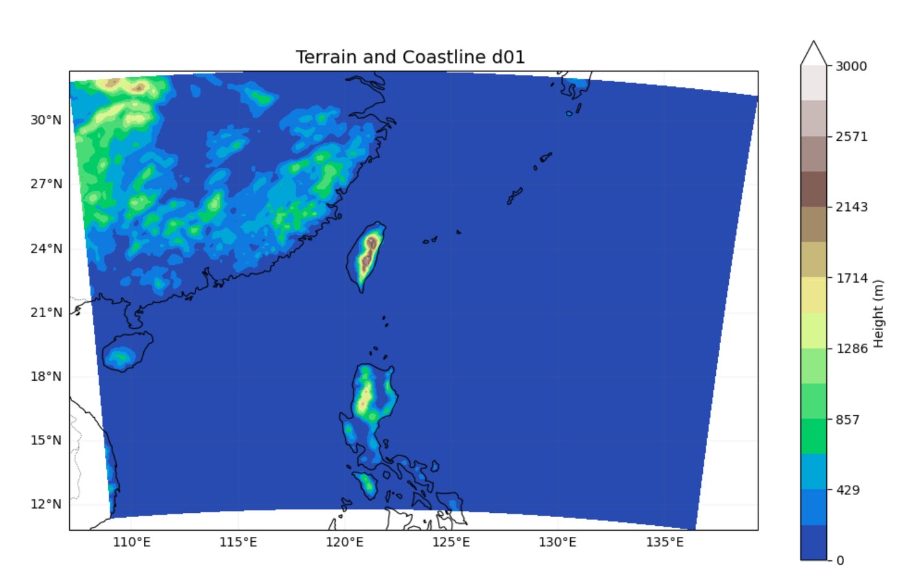
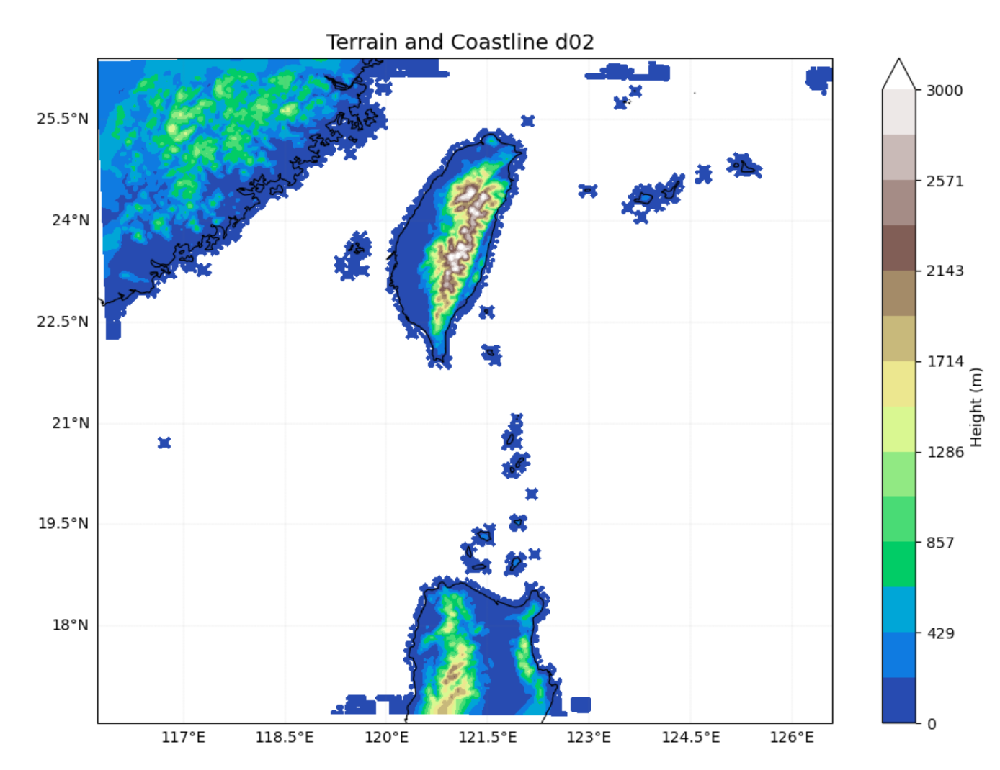
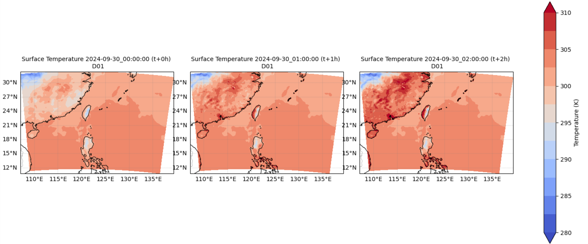
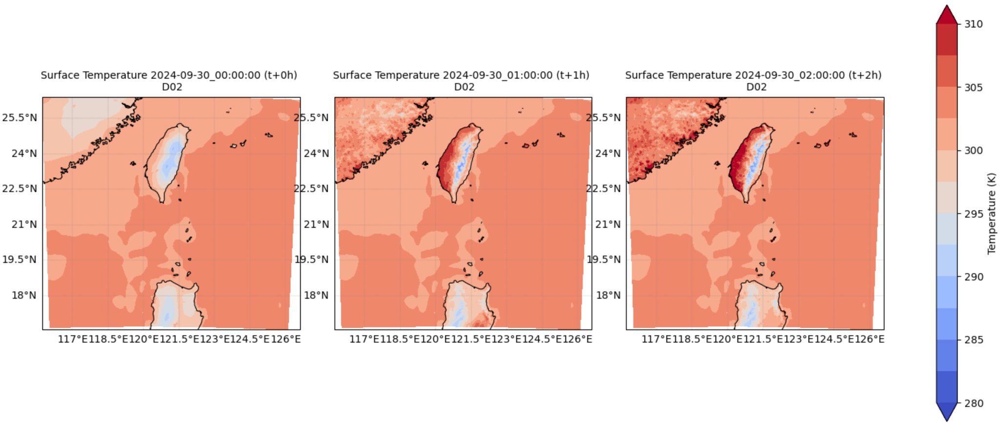
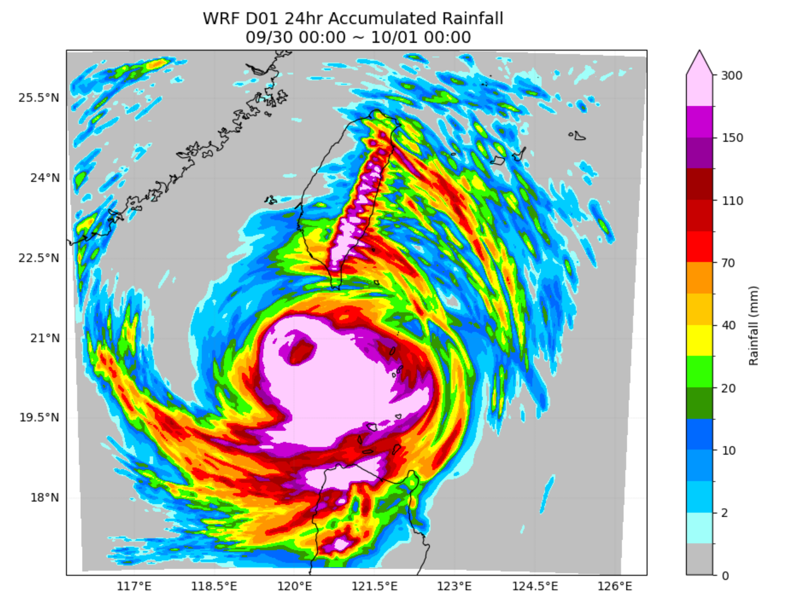
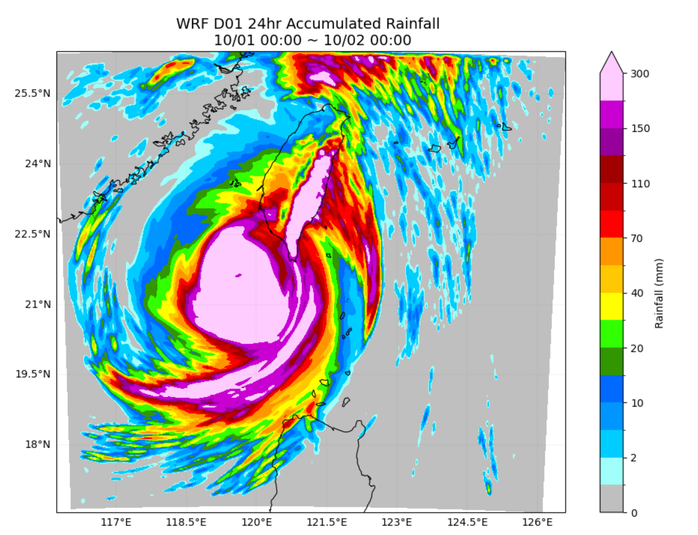
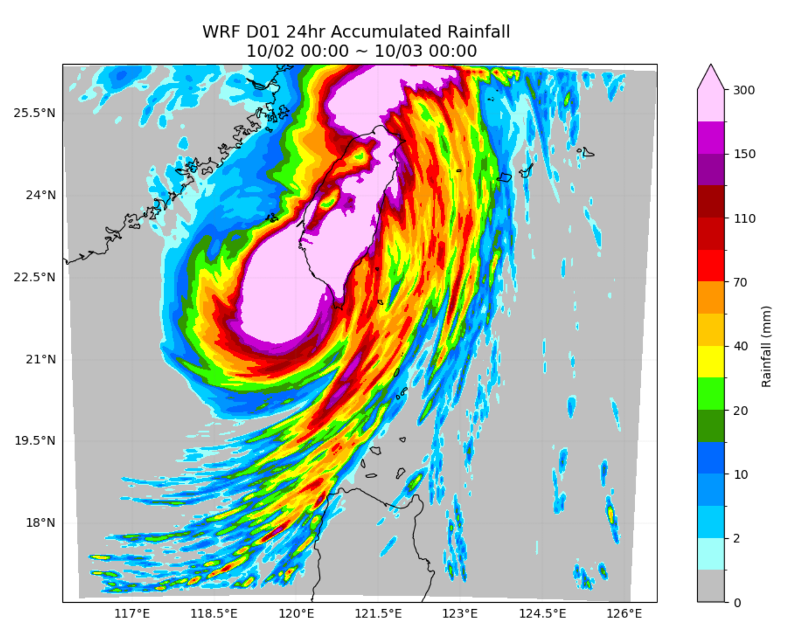

# WRF-Typhoon-Simulation

## Project Overview
This repository contains the workflow, configuration files, and Python post-processing scripts for a Weather Research and Forecasting (WRF v4.5.2) numerical simulation. The case study focuses on **Typhoon Krathon (2024)**, analyzing its track, intensity, surface thermal response, multi-scale precipitation patterns, and radar reflectivity across nested domains (D01 & D02).

---

## irectory Structure & Environment Settings
- **Root Directory:** `/work/u9792397/wrf/`[cite: 3]
- **Working / Script Directory:** `/work/u9792397/wrf/nwp`[cite: 3]
- **Environment:** Dedicated Anaconda environment with `wrf-python`, `netCDF4`, and `cartopy`[cite: 5].

---

## Assignment & Workflow Index (Questions 1 to 10)

### 1. Model Installation & Setup
- Successfully compiled and configured **WPS-4.5** and **WRFV4.5.2** using custom batch submission scripts (`compile_wrf_sbatch.sh`, `metgrid_sbatch.sh`) under standard HPC directory permissions[cite: 3, 5].

### 2. Domain Configuration (WPS Domain Settings)
- **Rationale:** Given Typhoon Krathon's southern track near Taiwan's southern offshore waters, **Domain 2 (D02)** was specifically configured to capture regional dynamics around southern Taiwan, while **Domain 1 (D01)** followed standard regional assignment guidelines[cite: 3].


### 3. Namelist Parameter Tuning & Troubleshooting


### 4. Workflow Execution Pipeline
The end-to-end numerical simulation workflow:
```text
WPS Geogrid/Metgrid ➔ Modify namelist.input ➔ real.sbatch (real.exe) ➔ Check real.error ➔ wrfrun_sbatch.sh (wrf.exe, ~4.5 hrs) ➔ wrfout generation ➔ Python Post-processing
```

### 5. Job Runtime Performance
- The full 3-day multi-domain simulation successfully completed via Slurm job scheduling in approximately **4 hours and 27 minutes** (`Job_id = 15453654`, `COMPLETED`)[cite: 5].

### 6. Terrain and Topography Comparison (D01 vs. D02)
- **D01:** Low resolution; major Taiwanese peaks above 3,000m are smoothed out, and marine boundaries are treated homogeneously near zero altitude[cite: 6].
- **D02:** High resolution; accurately resolves >3,000m alpine topography and clearly distinguishes complex land-sea boundaries around the Taiwanese coastline[cite: 6].
| D01 | D02 | 
| :--: | :--: |
|  |  |

### 7. Surface Temperature Spin-up Analysis ($t+0h$ to $t+2h$)
- **Initial Shock ($t+0h$):** Surface temperatures over land appear anomalously cool (flat areas $\sim 27^\circ\text{C}$, matching ocean temps $\sim 22^\circ\text{C}$; alpine areas $\sim 17^\circ\text{C}$)[cite: 6].
- **Simulation Response ($t+1h$ to $t+2h$):** Rapid adjustment occurs within the first hour. Western Taiwan land temperatures jump to $\sim 35^\circ\text{C}$, while mountain temperatures drop to $\sim 7^\circ\text{C}$[cite: 6]. 
- **Physical Implication:** This sharp initial adjustment indicates a spin-up shock between initial atmospheric fields and surface physics, which could introduce numerical oscillations affecting subsequent forecast accuracy[cite: 6].
| D01 | D02 | 
| :--: | :--: |
|  |  |

### 8. Multi-Day Accumulated Rainfall Validation ($24\text{-hr}$ Acc. Rain)
- **Day 1 (09/30 – 10/01):** Rainfall concentrated on the eastern side, matching observations. However, model overpredicted amounts exceeding $300\text{ mm}$ over Yilan/Hualien[cite: 7].
- **Day 2 (10/01 – 10/02):** Noticeable errors emerged. Model kept heavy precipitation ($>300\text{ mm}$) widespread across the east, whereas observations showed a southward shift toward Pingtung[cite: 7].
- **Day 3 (10/02 – 10/03):** Severe overestimation across most of Taiwan except the northwest, whereas actual heavy rainfall was concentrated in Taitung, Pingtung, Kaohsiung, and Keelung[cite: 7]. 
- **Hypothesis:** This excessive precipitation bias is likely linked to the high convection sensitivity of `mp_physics = 21`[cite: 8].
| Day 1 (09/30 – 10/01) | Day 2 (10/01 – 10/02) | Day 3 (10/02 – 10/03) | 
| :---: | :---: | :---: |
|  |  |  |

### 9. Radar Reflectivity & Wind Field Evolution ($2\text{-km}$ Level)
- **Variables & Tooling:** Extracted using `interplevel` for geopotential/wind vectors (`ua`, `va`) and reflectivity (`refl`) at $2\text{ km}$ altitude[cite: 8].
- **Synoptic Evolution:** Captured Typhoon Krathon lingering in southern offshore waters on 09/30, tracking westward, pivoting eastward toward Taiwan on 10/01, and eventually weakening over central Taiwan around the evening of 10/02[cite: 8, 9].

### 10. Typhoon Track Verification (Absolute Vorticity Method)
- **Methodology:** Tracked using the maximum **Absolute Vorticity (`avo`)** at the **$538\text{ hPa}$** level (tested across multiple vertical levels; $538\text{ hPa}$ yielded the closest alignment with observations compared to minimum pressure methods)[cite: 9].
- **Findings:** Successfully replicated the loop and northward trajectory from 09/30 to 10/02. Minor deviation occurred on 10/03 due to strong ambient wind interference over northern airspace affecting vortex core identification[cite: 9].
